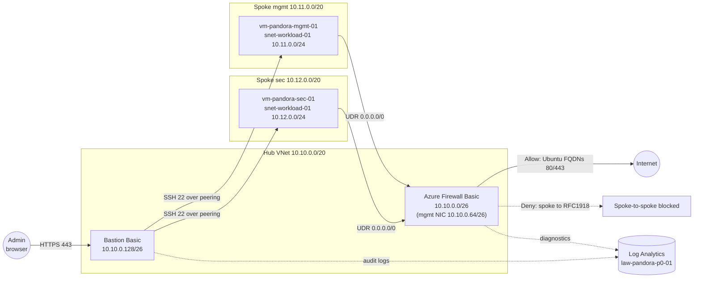

# Phase 0 topology

## Traffic flows

| Flow | Path | Control |
|---|---|---|
| Admin to VM | Browser -> Bastion (443) -> VM (SSH 22) over peering | NSG allows SSH only from `10.10.0.128/26` |
| VM to internet | VM -> UDR -> Firewall -> Internet | Allow-list of Ubuntu FQDNs; everything else default-deny; source NAT to the firewall public IP |
| Spoke to spoke | VM -> UDR -> Firewall | Denied (RFC1918 rule) |
| Spoke to hub subnet | Direct over peering (system route is more specific than the UDR) | **Bypasses the firewall.** Known limitation, see ADR-0003 |

All VMs have no public IP. Firewall and Bastion diagnostics go to Log Analytics.
